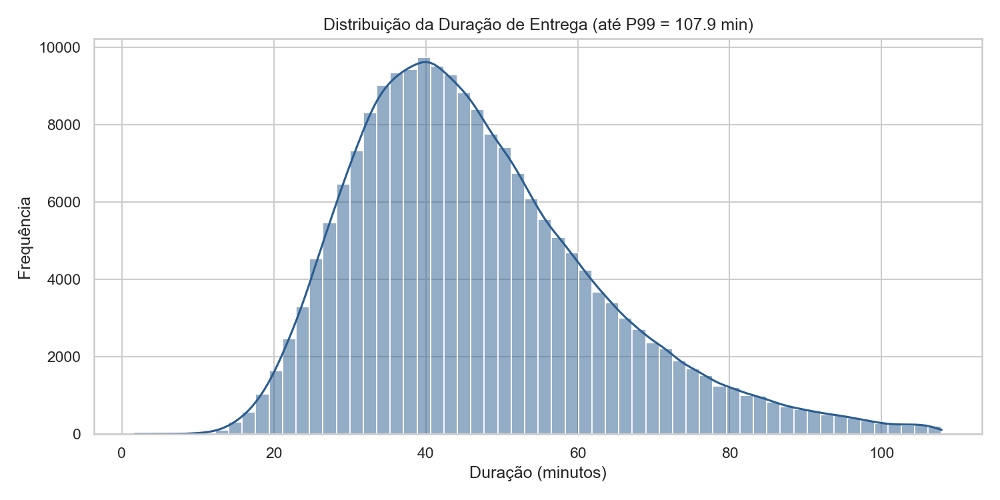
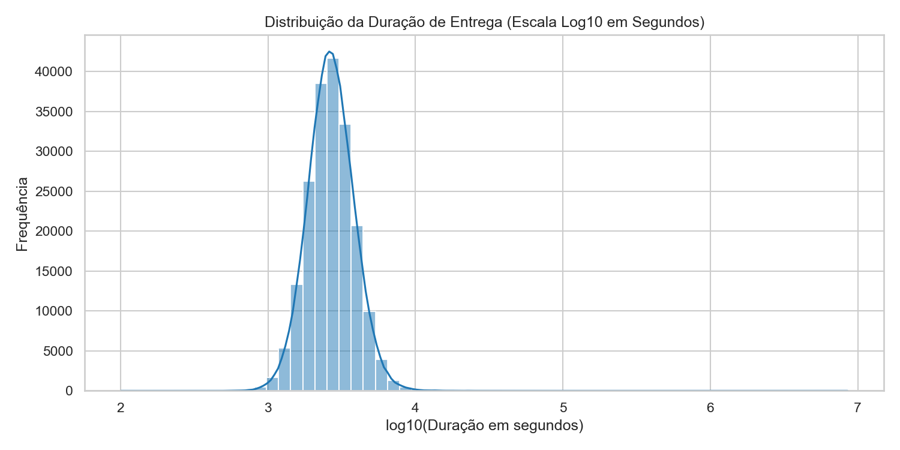
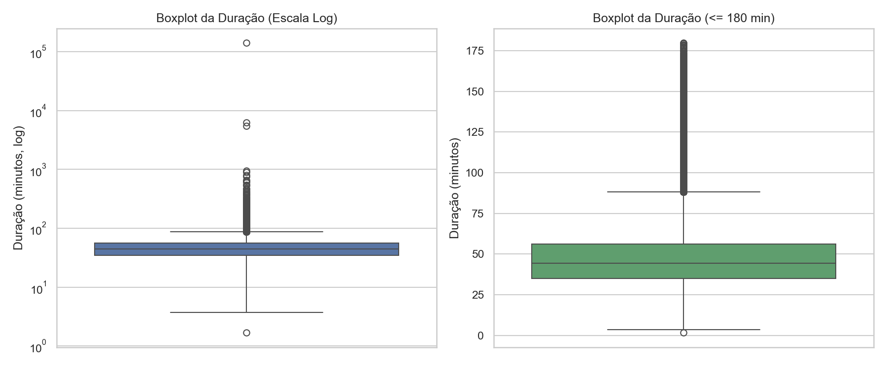
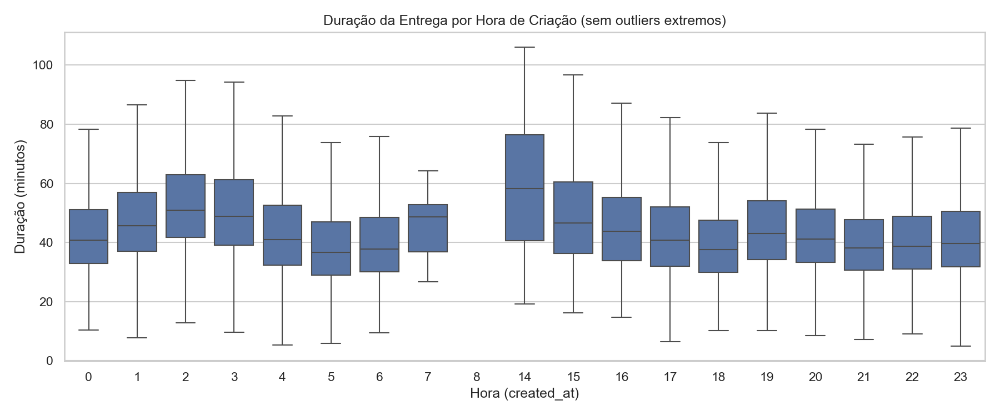
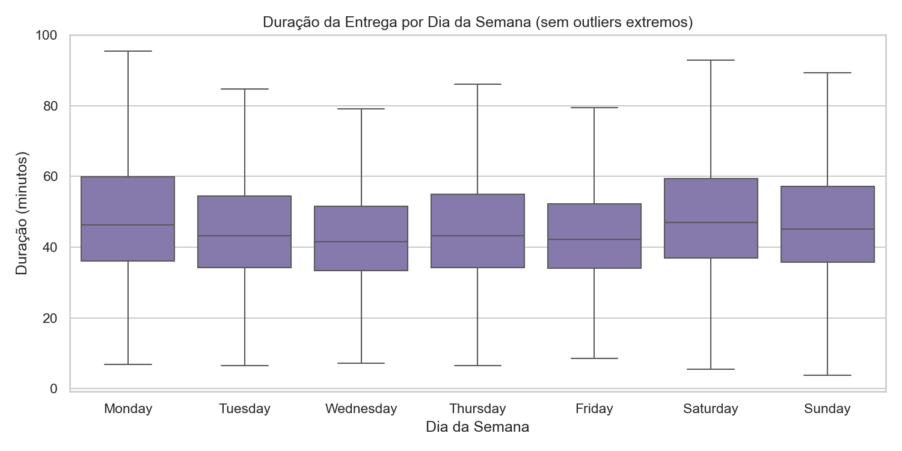
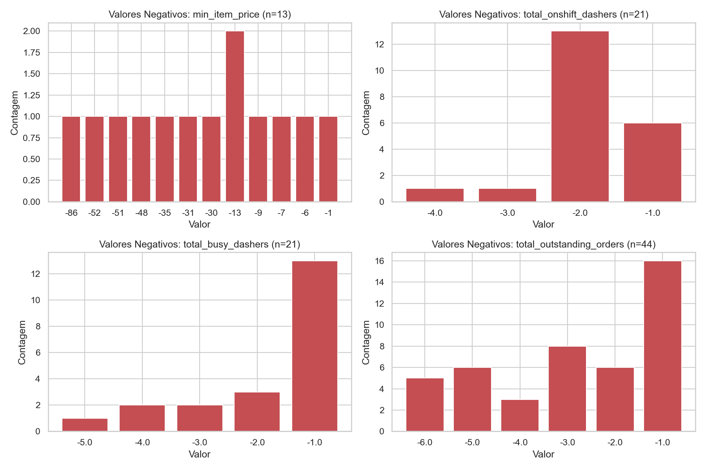
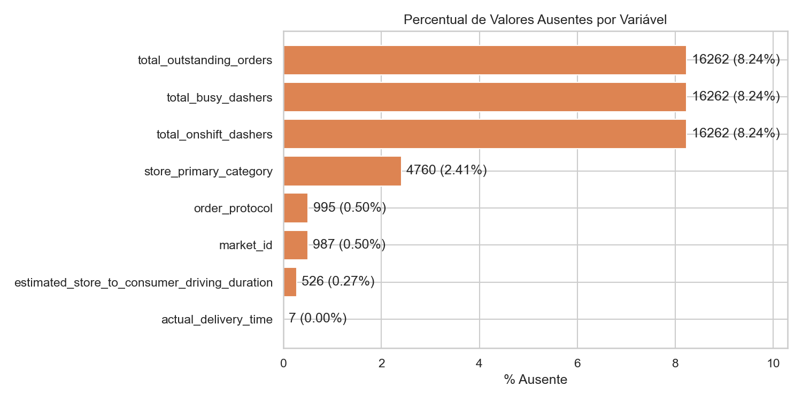

# DoorDash Delivery ETA — Relatório de Auditoria Aprofundada

**Dataset:** `data/raw/historical_data.csv` (`197.428` linhas × `16` colunas, `0` duplicatas exatas)  
**Notebook:** [01_data_quality_investigation.ipynb](../notebooks/01_data_quality_investigation.ipynb)

> **Nota metodológica:** Nenhuma linha foi removida, nenhum valor foi imputado ou substituído e o arquivo original permaneceu inalterado. Todas as constatações abaixo diferenciam **evidências observadas** de **hipóteses**.

---

## 1. Investigação da Variável-Alvo (`actual_delivery_time - created_at`)

### 1.1 Distribuição Geral e Percentis (Evidências Observadas)

Dos `197.428` registros, `197.421` possuem `actual_delivery_time` válido e `7` são nulos (`0,0035%`).

| Estatística | Segundos | Minutos |
| :--- | ---: | ---: |
| Contagem | 197.421 | 197.421 |
| Média | 2.908,26 | 48,47 |
| Desvio Padrão | 19.229,61 | 320,49 |
| Mínimo | 101,00 | 1,68 |
| **P1** | 1.152,00 | 19,20 |
| **P5** | 1.492,00 | 24,87 |
| **P10** | 1.699,00 | 28,32 |
| **P25** | 2.104,00 | 35,07 |
| **P50 (Mediana)** | 2.660,00 | 44,33 |
| **P75** | 3.381,00 | 56,35 |
| **P90** | 4.235,00 | 70,58 |
| **P95** | 4.872,00 | 81,20 |
| **P99** | 6.474,80 | 107,91 |
| **P99.9** | 9.934,86 | 165,58 |
| Máximo | 8.516.859,00 | 141.947,65 |

### 1.2 Contagem Acima de Limites Críticos

| Limite | Quantidade | % dos Válidos |
| :--- | ---: | ---: |
| > 60 min | 39.229 | 19,8707% |
| > 90 min | 5.645 | 2,8594% |
| > 120 min (2h) | 1.090 | 0,5521% |
| > 180 min (3h) | 138 | 0,0699% |
| > 360 min (6h) | 25 | 0,0127% |
| > 720 min (12h) | 7 | 0,0035% |
| > 1440 min (24h) | 3 | 0,0015% |

### 1.3 Os 3 Registros Acima de 24 Horas e Padrões de Outliers

| Índice | `created_at` | `actual_delivery_time` | Duração (s) | Duração (h) | `market_id` | `store_id` | Campos Operacionais |
| ---: | :--- | :--- | ---: | ---: | ---: | ---: | :--- |
| `2690` | `2014-10-19 05:24:15` | `2015-01-25 19:11:54` | 8.516.859 | 2.365,79 (~98,6 dias) | `1.0` | `3560` | `NaN` |
| `185550` | `2015-01-28 08:34:06` | `2015-02-01 16:25:25` | 373.879 | 103,86 (~4,3 dias) | `4.0` | `6503` | `0.0 / 0.0 / 0.0` |
| `27189` | `2015-02-16 02:24:09` | `2015-02-19 22:45:31` | 332.482 | 92,36 (~3,8 dias) | `1.0` | `4338` | `72.0 / 68.0 / 104.0` |

- **Evidências sobre os outliers (> 2h = 1.090 registros):**
  - O registro `2690` é o único com `created_at` em `2014-10-19` (todos os demais pedidos do dataset iniciam em `2015-01-21`).
  - Por mercado (`market_id`), a maior taxa de entregas > 2h ocorre no `market_id = 1.0` (`406` registros, `1,067%`), seguido por `NaN` (`9`, `0,912%`) e `3.0` (`142`, `0,610%`).
  - Por horário (`created_hour`), há concentração entre `02h` (`350` registros, `0,947%`) e `03h` (`200` registros, `0,739%`), além de taxas proporcionais altas em horários de baixíssimo volume (`08h`: 2 de 2; `14h`: 4 de 40; `15h`: 13 de 538).
  - Por data, `2015-02-02` concentra `261` dos `1.090` registros > 2h (~23,9% de todos os outliers > 2h).
- **Hipóteses:** O registro `2690` pode representar um pedido agendado/reprocessado ou erro de registro de data; o pico de `2015-02-02` e os atrasos > 24h podem refletir falhas pontuais de fechamento de pedido no sistema ou eventos operacionais atípicos.

---

## 2. Investigação de Valores Negativos

| Variável | Qtd. Negativos | % do Total | Faixa de Valores | Mercados Principais |
| :--- | ---: | ---: | :--- | :--- |
| `min_item_price` | 13 | 0,0066% | `-86` a `-1` | `2.0` (5), `1.0` (3), `5.0` (2), `3.0` (2), `6.0` (1) |
| `total_onshift_dashers` | 21 | 0,0106% | `-4` a `-1` (`-2.0`: 13 casos) | `1.0` (11), `3.0` (10) |
| `total_busy_dashers` | 21 | 0,0106% | `-5` a `-1` (`-1.0`: 13 casos) | `1.0` (13), `3.0` (7), `2.0` (1) |
| `total_outstanding_orders` | 44 | 0,0223% | `-6` a `-1` (`-1.0`: 16 casos) | `1.0` (22), `3.0` (16), `5.0` (3), `4.0` (2), `2.0` (1) |

- **Evidências observadas:**
  - `min_item_price < 0` não possui sobreposição com nenhuma das 3 variáveis operacionais negativas e ocorre em pedidos com `subtotal` positivo (de `951` a `6.095`).
  - `total_onshift_dashers < 0` ocorre exclusivamente nos mercados `1.0` e `3.0`; sobrepõe-se `1` vez com `total_busy_dashers < 0` (índice `119242`) e `3` vezes com `total_outstanding_orders < 0`.
  - `total_busy_dashers < 0` e `total_outstanding_orders < 0` sobrepõem-se `1` vez (índice `50842`).
- **Hipóteses:** Valores negativos em contagens de entregadores/pedidos podem resultar de dessincronização de contadores em tempo real (incrementos/decrementos fora de ordem); em `min_item_price`, podem refletir descontos ou ajustes de item lançados com sinal negativo.

---

## 3. Investigação de Valores Ausentes

### 3.1 Resumo por Variável

| Variável | Ausentes | % |
| :--- | ---: | ---: |
| `total_onshift_dashers` | 16.262 | 8,2369% |
| `total_busy_dashers` | 16.262 | 8,2369% |
| `total_outstanding_orders` | 16.262 | 8,2369% |
| `store_primary_category` | 4.760 | 2,4110% |
| `order_protocol` | 995 | 0,5040% |
| `market_id` | 987 | 0,4999% |
| `estimated_store_to_consumer_driving_duration` | 526 | 0,2664% |
| `actual_delivery_time` | 7 | 0,0035% |

### 3.2 Padrões Observados

- **Ausência simultânea:** Os três campos operacionais (`total_onshift_dashers`, `total_busy_dashers`, `total_outstanding_orders`) estão ausentes **exatamente nos mesmos `16.262` registros**. Nunca falta apenas um ou dois deles.
- **Padrão por mercado:** No `market_id = 6.0`, **95,47%** dos registros (`13.795` de `14.450`) têm os três campos operacionais ausentes. No `market_id = 3.0`, a taxa é de `6,95%` (`1.620` de `23.297`). Nos mercados `1, 2, 4, 5`, a ausência fica entre `0,45%` e `0,53%`.
- **Impacto na duração:** A mediana e os quartis são praticamente idênticos entre registros completos (`Q1=35,08`, `Mediana=44,37`, `Q3=56,38` min) e registros com ausência operacional (`Q1=34,87`, `Mediana=43,92`, `Q3=56,08` min). A média sobe de `47,77` para `56,26` min devido ao outlier de `98,6` dias (índice `2690`), que também tem campos operacionais nulos.
- **Hipótese:** A telemetria de entregadores/pedidos pendentes provavelmente não estava habilitada ou integrada de forma consistente no `market_id = 6.0`.

---

## 4. Indicadores Operacionais (`total_busy_dashers > total_onshift_dashers`)

- **Quantidade e percentual:** Dos `181.166` registros com ambos os campos válidos, **`40.394` (`22,30%` dos válidos; `20,46%` do total)** possuem `total_busy_dashers > total_onshift_dashers`.
- **Distribuição da diferença (`busy - onshift`):** Mínimo `1`, Q1 `1`, Mediana `3`, Média `7,98`, Q3 `10`, Máximo `64`.
- **Por mercado (% sobre válidos):** `market_id = 1.0` (`26,71%`), `2.0` (`26,03%`), `6.0` (`21,37%`), `4.0` (`19,70%`), `3.0` (`17,18%`), `5.0` (`14,65%`).
- **Avaliação:** Por ocorrer em mais de um quinto dos dados válidos em todos os mercados, **não deve ser classificado automaticamente como dado inválido**.
- **Hipótese:** Entregadores podem aceitar/concluir pedidos fora da janela formal de turno (*onshift*) ou haver defasagem de atualização entre os dois contadores.

---

## 5. Recomendações para a Próxima Etapa (Pré-processamento e EDA)

1. **Variável-alvo:**
   - Remover os `7` registros com `actual_delivery_time` nulo na criação do dataset processado (sem alvo não há treino supervisionado).
   - Tratar explicitamente os outliers extremos (ex.: os `3` casos > 24h e avaliar regra de corte ou Winsorização/avaliação separada para `> 2h` / `> 3h`), documentando o impacto nas métricas (RMSE vs MAE).
2. **Valores negativos:**
   - Como representam `< 0,03%` dos dados, decidir de forma explícita e documentada entre corrigir/anular para `NaN` + imputação ou filtrar na etapa de limpeza — **sempre preservando `data/raw/historical_data.csv`**.
3. **Valores ausentes:**
   - Criar flags indicadoras de ausência (especialmente `is_operational_missing`), já que a ausência dos 3 campos operacionais está fortemente ligada ao `market_id = 6.0`.
   - Definir estratégia de imputação (ex.: mediana por mercado/horário ou modelo baseado em árvores que lida nativamente com `NaN`) dentro de `Pipeline` para evitar *data leakage*.
4. **`total_busy_dashers > total_onshift_dashers`:**
   - Manter os registros e testar features derivadas como `busy_ratio = total_busy_dashers / (total_onshift_dashers + 1)` ou `dasher_diff = total_onshift_dashers - total_busy_dashers`.
