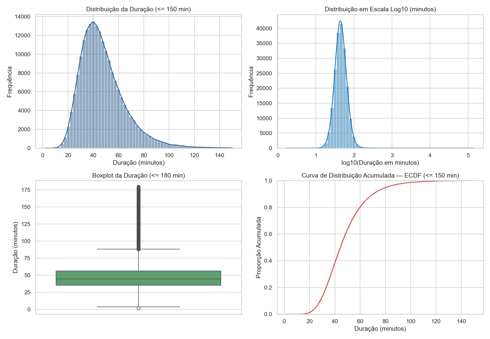
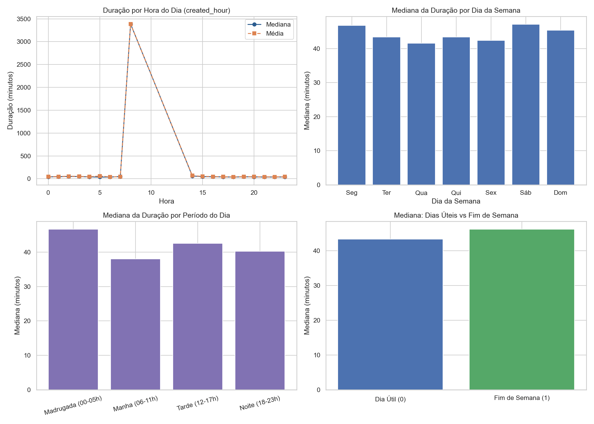
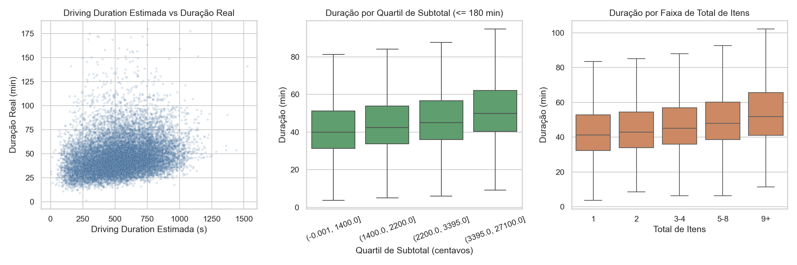
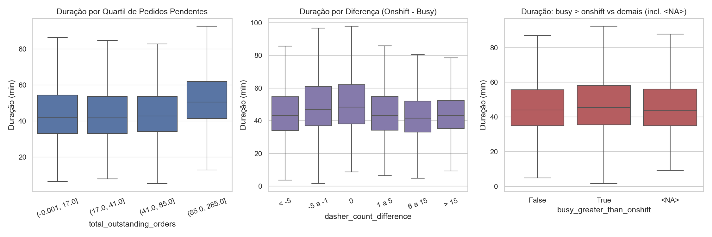
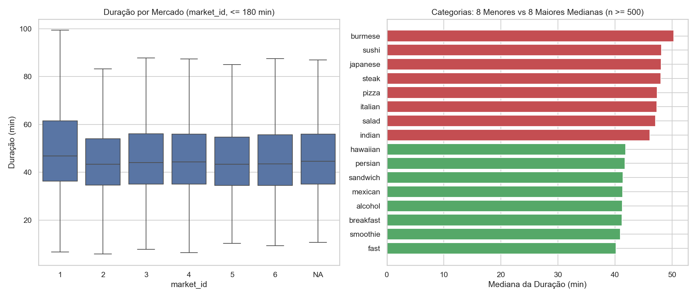
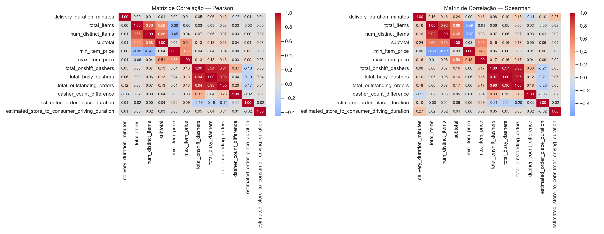

# DoorDash Delivery ETA — Relatório de Análise Exploratória (EDA)

**Base analisada:** `df_model` gerado por [data_preparation.py](../src/data_preparation.py) a partir de `data/raw/historical_data.csv`  
**Tamanho da amostra:** `197.421` registros com alvo válido (`delivery_duration_minutes > 0`)  
**Notebook:** [03_exploratory_data_analysis.ipynb](../notebooks/03_exploratory_data_analysis.ipynb)

> **Princípio de análise:** Todos os resultados abaixo referem-se a evidências observadas na amostra (`n` informado em cada tabela). Correlações e padrões não implicam causalidade, e interpretações especulativas são explicitamente separadas como **hipóteses**.

---

## 1. Perguntas Investigadas

1. Como se distribui `delivery_duration_minutes` e qual o peso da cauda superior?
2. Quais padrões temporais (hora, dia da semana, período, fim de semana) estão associados à duração?
3. Como características do pedido (itens, subtotal, estimativas de deslocamento e colocação) se relacionam com o tempo real?
4. Como indicadores operacionais (`total_onshift_dashers`, `total_busy_dashers`, `total_outstanding_orders`, `dasher_count_difference`) e suas ausências se comportam?
5. Há diferenças relevantes entre mercados (`market_id`), categorias (`store_primary_category`) e restaurantes (`store_id`)?
6. Por que Pearson e Spearman divergem neste dataset?
7. Quais variáveis estão realmente disponíveis no momento da criação do pedido (sem risco de vazamento)?

---

## 2. Resultados Encontrados

### 2.1 Distribuição da Variável-Alvo (`n = 197.421`)

- **Percentis:** P50 = `44,33 min` | P75 = `56,35 min` | P90 = `70,58 min` | P95 = `81,20 min` | P99 = `107,91 min` | P99.9 = `165,58 min`.
- **Faixas de duração:**

| Faixa | Quantidade (`n`) | % |
| :--- | ---: | ---: |
| `<= 30 min` | 25.976 | 13,16% |
| `30-45 min` | 76.157 | 38,58% |
| `45-60 min` | 56.059 | 28,40% |
| `60-90 min` | 33.584 | 17,01% |
| `90-120 min` | 4.555 | 2,31% |
| `> 120 min` | 1.090 | 0,55% |

- `80,14%` dos pedidos são entregues em até `60` minutos. Os `3` registros extremos acima de `24h` (`141.947,65 min`, `6.231,32 min` e `5.541,37 min`) inflam o desvio padrão (`320,49 min`) e a média (`48,47 min`) em relação à mediana (`44,33 min`).

### 2.2 Análise Temporal (`n = 197.421`)

- **Por período do dia:**
  - `Madrugada (00-05h)` concentra a maior parte da amostra (`n = 127.243`) e a maior mediana (`46,62 min`, IQR `21,87`).
  - `Noite (18-23h)` (`n = 62.649`) tem mediana `40,23 min` (IQR `18,68`).
  - `Tarde (12-17h)` (`n = 6.100`, mediana `42,55 min`) e `Manhã (06-11h)` (`n = 1.429`, mediana `38,02 min`) têm volume bem menor.
  - *Nota:* O pico de volume entre `01h–03h` UTC sugere possível fuso horário UTC nos timestamps (hipótese consistente com horários de jantar nos EUA, a confirmar).
- **Por hora do dia:** Pico de mediana às `02h` (`51,22 min`, `n = 36.973`) e `03h` (`49,08 min`, `n = 27.068`). Horários `08h` (`n = 2`) e `14h` (`n = 40`) têm amostra muito pequena para generalização.
- **Dias úteis vs Fim de semana:**
  - Dias úteis (`n = 129.265`): mediana `43,38 min` (IQR `20,57`).
  - Fim de semana (`n = 68.156`): mediana `46,20 min` (IQR `22,23`). Sábado (`5`) tem a maior mediana (`47,10 min`, `n = 34.541`) e quarta-feira (`2`) a menor (`41,58 min`, `n = 24.254`).

### 2.3 Características dos Pedidos

| Variável | `n` | Pearson | Spearman |
| :--- | ---: | ---: | ---: |
| `estimated_store_to_consumer_driving_duration` | 196.895 | 0,0122 | **0,2659** |
| `subtotal` | 197.421 | 0,0112 | **0,2354** |
| `num_distinct_items` | 197.421 | 0,0067 | **0,1610** |
| `max_item_price` | 197.421 | 0,0094 | **0,1600** |
| `total_items` | 197.421 | 0,0049 | **0,1556** |
| `estimated_order_place_duration` | 197.421 | 0,0092 | **0,1035** |
| `min_item_price` | 197.408 | 0,0048 | 0,0022 |

- **Relações monotônicas observadas:**
  - `estimated_store_to_consumer_driving_duration` por quartis: mediana sobe de `38,82 min` (Q1: `<= 382s`) para `49,62 min` (Q4: `> 702s`).
  - `subtotal` por quartis: mediana sobe de `39,98 min` (Q1: `<= 1400`) para `49,82 min` (Q4: `> 3395`).
  - `total_items`: mediana sobe de `41,18 min` (`1` item) para `51,92 min` (`9+` itens).
- **`estimated_order_place_duration`:** Apenas dois valores (`251` em `139.008` linhas e `446` em `58.219` linhas) respondem por `99,9%` dos pedidos e seguem fortemente o `order_protocol`.

### 2.4 Análise Operacional

| Variável | `n` | Pearson | Spearman |
| :--- | ---: | ---: | ---: |
| `total_outstanding_orders` | 181.115 | 0,1224 | **0,1800** |
| `dasher_count_difference` | 181.118 | -0,0287 | **-0,1076** |
| `total_busy_dashers` | 181.138 | 0,0606 | 0,1050 |
| `total_onshift_dashers` | 181.138 | 0,0470 | 0,0805 |

- **`total_outstanding_orders`:** No quartil superior (`> 85` pedidos pendentes, `n = 44.804`), a mediana salta para `50,47 min` (contra `41,77–42,72 min` nos três primeiros quartis), indicando comportamento não linear sob congestionamento.
- **`dasher_count_difference` (`onshift - busy`):** Comportamento não monotônico nas caudas: mediana atinge pico em `0` (`48,38 min`, `n = 35.910`) e `-5 a -1` (`47,00 min`, `n = 24.332`), caindo para `41,55 min` quando há folga de `6 a 15` entregadores (`n = 31.943`).
- **`busy_greater_than_onshift`:** `True` (`n = 40.373`, mediana `45,45 min`) é ligeiramente maior que `False` (`n = 140.745`, mediana `44,08 min`). Registros `<NA>` (`n = 16.303`) têm mediana `43,93 min` (muito próxima de `False`).

### 2.5 Restaurantes e Mercados

- **Por `market_id`:** `market_id = 1` (`n = 38.037`) tem a maior mediana (`46,90 min`) e maior variabilidade (`IQR = 25,28 min`, `std = 728,45` devido ao outlier de `98,6` dias). `market_id = 2` (`n = 55.055`) tem a menor mediana (`43,35 min`, `IQR = 19,42`).
- **Por `store_primary_category` (`38` categorias com `n >= 500` de `74` totais):**
  - *Maiores medianas:* `burmese` (`50,30 min`, `n = 821`), `sushi` (`48,17 min`, `n = 2.187`), `japanese` (`48,12 min`, `n = 9.195`), `steak` (`48,07 min`, `n = 1.092`), `pizza` (`47,40 min`, `n = 17.320`).
  - *Menores medianas:* `fast` (`40,18 min`, `n = 7.371`), `smoothie` (`40,95 min`, `n = 1.659`), `breakfast` (`41,25 min`, `n = 5.425`), `alcohol` (`41,28 min`, `n = 1.850`), `mexican` (`41,35 min`, `n = 17.098`).
- **Por `store_id` (`442` lojas com `n >= 100` de `6.743` totais):** Grande amplitude entre lojas com volume relevante: de `29,06 min` (`store_id = 570`, `n = 102`) até `75,22 min` (`store_id = 400`, `n = 115`).

### 2.6 Correlações: Pearson vs Spearman

- As correlações de **Pearson** com `delivery_duration_minutes` ficam próximas de zero (`0,0048` a `0,1224`) porque os `3` outliers extremos acima de `24h` distorcem fortemente a variância e a covariância linear.
- As correlações de **Spearman** (baseadas em postos, robustas a outliers e relações monotônicas não lineares) revelam sinais consistentes: `estimated_store_to_consumer_driving_duration` (`0,2659`), `subtotal` (`0,2354`), `total_outstanding_orders` (`0,1800`) e `num_distinct_items` (`0,1610`).

---

## 3. Investigação de Disponibilidade Temporal das Features (No Momento do Pedido)

| Variável | Classificação | Justificativa | Fonte de Incerteza |
| :--- | :--- | :--- | :--- |
| `created_at` (e derivadas) | **Potencialmente disponível** | Timestamp de criação do pedido. | Fuso horário (aparente UTC). |
| `market_id`, `store_id`, `store_primary_category`, `order_protocol` | **Potencialmente disponível** | Metadados estáticos do restaurante/pedido no checkout. | `NaN` em `market_id`, `order_protocol` e `store_primary_category`. |
| `total_items`, `subtotal`, `num_distinct_items`, `min_item_price`, `max_item_price` | **Potencialmente disponível** | Composição do carrinho fechada no momento do pedido. | Ajustes pós-pedido ou descontos (`min_item_price < 0`). |
| `estimated_order_place_duration` | **Potencialmente disponível** | `99,9%` dos valores são constantes (`251` ou `446`) ligadas ao `order_protocol`. | Pequena fração (`0,1%`) com valores variados pode ser atualização posterior. |
| `estimated_store_to_consumer_driving_duration` | **Disponibilidade ainda não confirmada** | Estimativa de rota restaurante→cliente pode ser calculada no checkout por GPS/roteamento. | Não há documentação explícita se foi congelada no `created_at` ou recalculada ao alocar entregador. |
| `total_onshift_dashers`, `total_busy_dashers`, `total_outstanding_orders` | **Disponibilidade ainda não confirmada** | Retratam estado do marketplace (oferta/demanda). | Podem ser snapshot do `created_at` ou janela agregada posterior; `95,47%` ausente no mercado 6. |
| `actual_delivery_time` | **Indisponível (Alvo)** | Evento futuro que define o alvo. **Nunca usar como feature.** | — |

---

## 4. Hipóteses para Feature Engineering

1. **Razões de pressão operacional (com cuidado para `onshift == 0`):** `outstanding_orders / (onshift_dashers + 1)` e `busy_dashers / (onshift_dashers + 1)` podem capturar congestionamento melhor que contagens absolutas.
2. **Interações entre tempo estimado e congestionamento:** `estimated_store_to_consumer_driving_duration + estimated_order_place_duration` como baseline aditivo, e interação com `total_outstanding_orders`.
3. **Sinais de ausência:** Flag `is_operational_missing` (captura padrão do `market_id = 6` e falhas de telemetria).
4. **Agregações históricas por `store_id` e `store_primary_category`:** Target encoding ou estatísticas por loja **calculadas estritamente dentro do conjunto de treino / folds de validação cruzada** (para evitar data leakage), dada a forte variação entre lojas (`29` a `75 min`).
5. **Atributos de preço médio e dispersão do pedido:** `subtotal / total_items` e `max_item_price - min_item_price`.

---

## 5. Limitações e Pontos a Investigar

- **Outliers extremos (`> 24h`):** Distorcem métricas quadráticas (RMSE/Pearson); será necessário definir na etapa de modelagem uma estratégia clara (ex.: avaliação em amostra filtrada vs completa, uso de MAE/Huber/log-target).
- **Janela temporal curta (~1 mês principal):** Dados concentrados entre `2015-01-21` e `2015-02-18` (exceto 1 registro de `2014-10-19`), limitando sazonalidade anual.
- **Viés de mercado e cobertura:** `Madrugada (00-05h)` domina o volume (provável UTC); `market_id = 6` tem `95,47%` de ausência operacional.
- **Variáveis confundidoras:** `total_onshift_dashers` e `total_busy_dashers` têm correlação positiva fraca com a duração porque mercados/horários mais movimentados têm tanto mais entregadores quanto mais atraso.
- **Risco de vazamento:** Qualquer estatística por `store_id`, imputação ou scaler deve ser ajustado **apenas nos dados de treino**, e a divisão treino/validação deve respeitar a ordem temporal (`created_at`).
