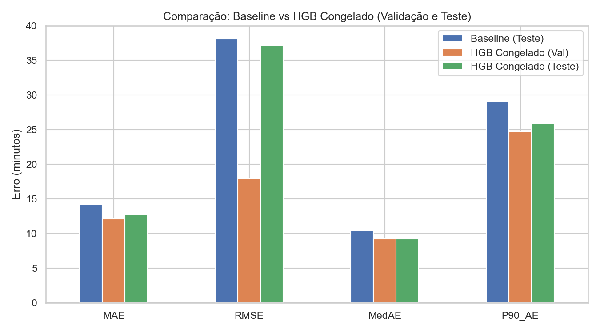
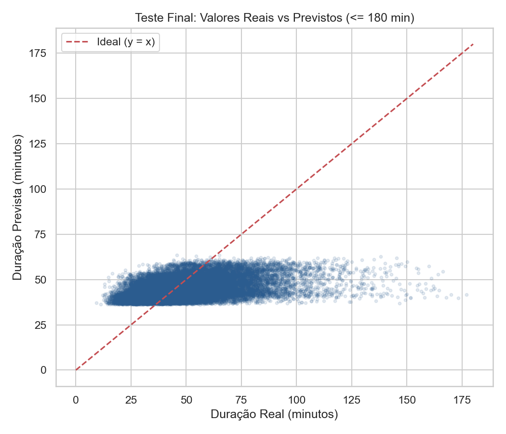
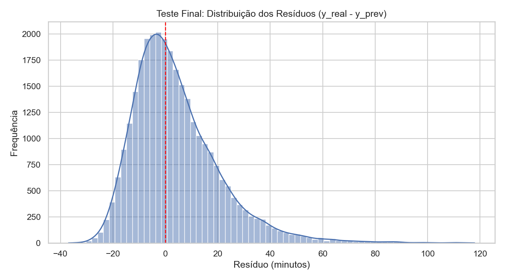
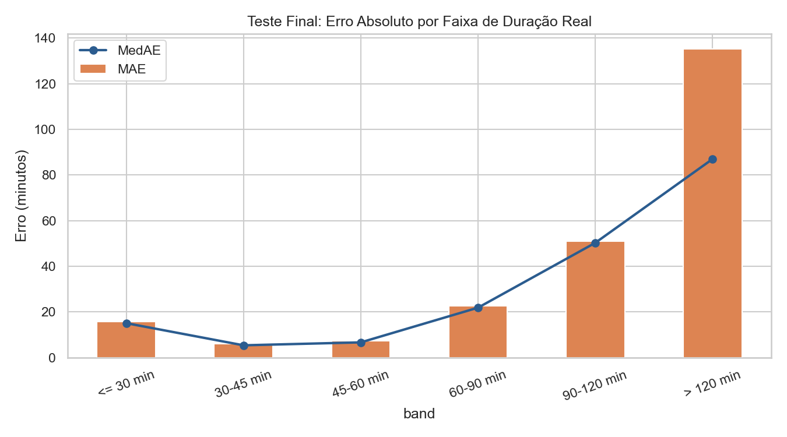

# DoorDash Delivery ETA — Relatório de Avaliação Final no Conjunto de Teste (Etapa 07)

**Data de execução:** `2026-11-17T16:25:07-03:00`  
**Notebook:** [07_final_test_evaluation.ipynb](../notebooks/07_final_test_evaluation.ipynb)  
**Métricas (JSON):** [final_test_metrics.json](final_test_metrics.json)  
**Pipeline salvo:** `models/final_hgb_eta_pipeline.joblib`

---

## 1. Configuração Congelada Avaliada

- **Modelo:** `HistGradientBoostingRegressor`
- **Parâmetros:** `loss="absolute_error"`, `learning_rate=0.08`, `max_iter=20`, `max_leaf_nodes=63`, `min_samples_leaf=30`, `l2_regularization=0.0`, `early_stopping=False`, `random_state=42`
- **Features:** `CONFIRMED_MODEL_FEATURES` (`21` variáveis confirmadas; `store_id` e variáveis experimentais excluídos)
- **Target:** `delivery_duration_minutes`
- **Divisão temporal (Etapa 05):**
  - Treino: `138.572` registros (`created_at < 2015-02-10 10:00:00`, `actual_delivery_time` máx: `2015-02-10 06:55:06`)
  - Validação: `28.808` registros (`2015-02-10 14:37:17` – `2015-02-14 07:00:55`)
  - Teste: `30.041` registros (`2015-02-14 14:37:07` – `2015-02-18 06:00:44`, todos mantidos)
- **Versões:** Python `3.12.3` | `pandas 2.3.1` | `numpy 2.3.2` | `scikit-learn 1.8.0` | `scipy 1.17.1` | `joblib 1.5.3` | `matplotlib 3.10.6` | `seaborn 0.13.2`
- **Tempo de treino:** `4,21 s` | **Inferência no teste (`30.041`):** `0,122 s`

---

## 2. Resultados no Conjunto de Teste (`n = 30.041`) e Comparação com Baseline

| Métrica | Baseline (Median) — Teste | HGB Congelado — Teste | Diferença Absoluta | Diferença % |
| :--- | ---: | ---: | ---: | ---: |
| **MAE (min)** | 14,1955 | **12,7797** | **-1,4158** | **-9,97%** |
| **RMSE (min)** | 38,1036 | **37,1903** | **-0,9133** | **-2,40%** |
| **MedAE (min)** | 10,4667 | **9,2282** | **-1,2385** | **-11,83%** |
| **P90_AE (min)** | 29,0833 | **25,9125** | **-3,1708** | **-10,90%** |
| **R²** | -0,0195 | **+0,0288** | +0,0483 | — |
| **Mean Bias (min)** | -5,2643 | -4,6494 | — | — |
| **Median Bias (min)** | -1,4500 | -1,1213 | — | — |

- O modelo congelado superou o baseline em **todas** as métricas de erro no teste, reduzindo o MAE em `9,97%` (`1,42 min`), a MedAE em `11,83%` e o P90_AE em `10,90%`.

---

## 3. Comparação Validação vs Teste (Generalização Temporal)

| Conjunto | Modelo | MAE | RMSE | MedAE | P90_AE | R² | Mean Bias |
| :--- | :--- | ---: | ---: | ---: | ---: | ---: | ---: |
| **Validação** (`n=28.808`) | Baseline | 12,8201 | 18,6790 | 9,9000 | 25,6667 | -0,0341 | -3,3927 |
| **Validação** (`n=28.808`) | HGB Congelado | 12,1142 | 17,9219 | 9,2317 | 24,7196 | +0,0480 | -2,8943 |
| **Teste** (`n=30.041`) | Baseline | 14,1955 | 38,1036 | 10,4667 | 29,0833 | -0,0195 | -5,2643 |
| **Teste** (`n=30.041`) | HGB Congelado | 12,7797 | 37,1903 | 9,2282 | 25,9125 | +0,0288 | -4,6494 |

- **Análise de generalização:** A `MedAE` do modelo congelado manteve-se praticamente idêntica entre validação (`9,23 min`) e teste (`9,23 min`), e o ganho relativo sobre o baseline ampliou-se (`-1,42 min` no teste vs `-0,71 min` na validação).
- **Por que MAE e RMSE absolutos subiram no teste?** O próprio baseline constante piorou fortemente no teste (`MAE 12,82 → 14,20`; `RMSE 18,68 → 38,10`), refletindo uma mudança na distribuição do alvo no período de teste (`2015-02-14` a `2015-02-18`), que inclui maior proporção de entregas `> 120 min` (`191` no teste vs `116` na validação) e um outlier extremo `> 24h` (`5.541,37 min`).

---

## 4. Diagnóstico de Erros no Conjunto de Teste (`n = 30.041`)

- **Previsões negativas (`< 0`):** `0`
- **Erros absolutos por limite:**
  - `> 30 min`: `2.232` (`7,43%`)
  - `> 60 min`: `351` (`1,17%`)
  - `> 90 min`: `76` (`0,25%`)
  - `> 120 min`: `25` (`0,08%`)

### 4.1 Erros por Faixa de Duração Real

| Faixa de Duração Real | `n` | MAE (min) | MedAE (min) | P90_AE (min) | Mean Bias (min) |
| :--- | ---: | ---: | ---: | ---: | ---: |
| `<= 30 min` | 3.453 | 15,62 | 15,05 | 21,86 | +15,62 |
| `30-45 min` | 11.214 | **6,10** | **5,35** | 12,25 | +5,21 |
| `45-60 min` | 8.574 | 7,35 | 6,64 | 14,49 | -6,23 |
| `60-90 min` | 5.794 | 22,65 | 21,85 | 35,48 | -22,65 |
| `90-120 min` | 815 | 50,96 | 50,28 | 64,97 | -50,96 |
| **`> 120 min`** | **191** | **135,20** | **87,00** | **135,46** | **-135,20** |

### 4.2 Registros Extremos no Teste (Top 5 Maiores Erros Absolutos)

| Índice | `created_at` | `actual_delivery_time` | Real (min) | Previsto (min) | Erro Abs. (min) |
| ---: | :--- | :--- | ---: | ---: | ---: |
| `27187` | `2015-02-16 02:24:09` | `2015-02-19 22:45:31` | 5.541,37 (~92,4h) | 58,84 | 5.482,53 |
| `190853` | `2015-02-16 02:31:05` | `2015-02-16 17:38:32` | 907,45 (~15,1h) | 59,49 | 847,96 |
| `76741` | `2015-02-15 04:17:35` | `2015-02-15 16:59:00` | 761,42 (~12,7h) | 46,37 | 715,04 |
| `31183` | `2015-02-14 22:23:13` | `2015-02-15 07:19:12` | 535,98 (~8,9h) | 38,24 | 497,74 |
| `29713` | `2015-02-14 21:08:06` | `2015-02-15 04:14:44` | 426,63 (~7,1h) | 36,74 | 389,90 |

*(Os `20` maiores erros absolutos no teste correspondem a entregas reais entre `177,10` e `5.541,37 min`, para as quais o modelo previu entre `36,74` e `59,49 min`.)*

---

## 5. Limitações e Avaliação Honesta de Prontidão

- **O modelo NÃO está pronto para produção real.** Embora supere consistentemente o baseline com rigor metodológico e zero vazamento, o `R² = +0,0288` no teste indica que metadados estáticos do pedido e atributos temporais explicam apenas uma fração pequena da variância do tempo de entrega.
- **Principais lacunas:** (1) ausência de sinais em tempo real confirmados de congestionamento operacional e distância/tempo de rota (`driving_duration`), que nas ablações de validação elevaram o R² para `+0,1538`; (2) ausência do efeito específico por restaurante (`store_id`) via *target encoding* temporal causal; e (3) incapacidade de antecipar atrasos extremos (`> 90 min` / `> 24h`) a partir apenas das 21 variáveis confirmadas.
