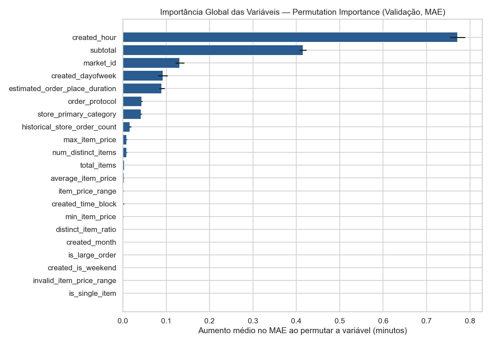
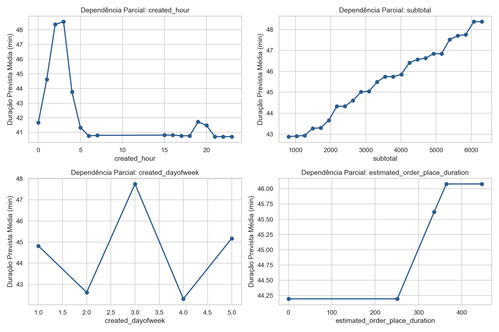
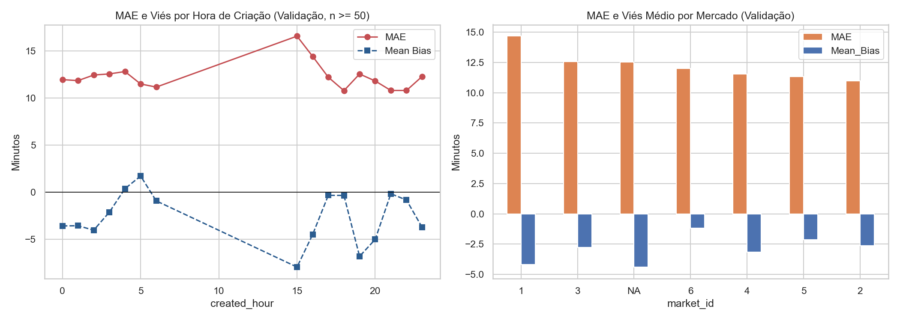
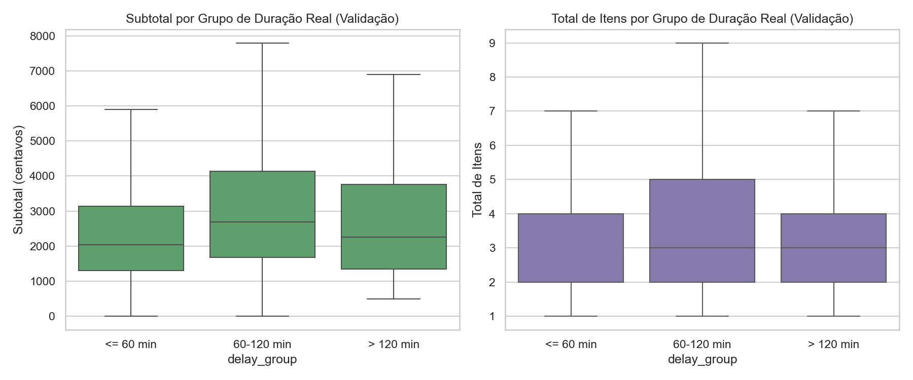

# DoorDash Delivery ETA — Relatório de Interpretabilidade e Investigação de Erros (Etapa 08)

**Modelo oficial inspecionado:** `models/final_hgb_eta_pipeline.joblib` (inalterado e não retreinado)  
**Notebook:** [08_model_interpretability.ipynb](../notebooks/08_model_interpretability.ipynb)  
**Tabela completa de importância:** [feature_importance.csv](feature_importance.csv)

---

## 1. Metodologia

- **Auditoria do pipeline:** Confirmou-se que o pipeline recebe exclusivamente as `21` variáveis de `CONFIRMED_MODEL_FEATURES`, expande-as para `111` colunas após `OneHotEncoder`, e **não** utiliza `actual_delivery_time` nem variáveis derivadas do alvo.
- **Importância global e dependência:** Aplicou-se **Permutation Importance** (`neg_mean_absolute_error`, `n_repeats=10`, `random_state=42`) e **Dependência Parcial** (`partial_dependence`) sobre o conjunto de validação (`n = 28.808`), mantendo o conjunto de teste totalmente isolado. *(Nota: `shap` não estava instalado no ambiente; a combinação de Permutation Importance no pipeline completo + Partial Dependence fornece explicabilidade global e direcional direta nas 21 features originais.)*
- **Nota metodológica:** Importância preditiva mede contribuição estatística para reduzir o MAE na validação, **não** relação causal.

---

## 2. Importância das Variáveis (Top 10 na Validação)

| Rank | Feature | Aumento Médio no MAE (min) | Desvio Padrão |
| ---: | :--- | ---: | ---: |
| 1 | `created_hour` | **+0,77159** | 0,01724 |
| 2 | `subtotal` | **+0,41535** | 0,00803 |
| 3 | `market_id` | **+0,13144** | 0,00992 |
| 4 | `created_dayofweek` | **+0,09240** | 0,01085 |
| 5 | `estimated_order_place_duration` | **+0,08987** | 0,00651 |
| 6 | `order_protocol` | +0,04374 | 0,00158 |
| 7 | `store_primary_category` | +0,04217 | 0,00158 |
| 8 | `historical_store_order_count` | +0,01650 | 0,00258 |
| 9 | `max_item_price` | +0,00882 | 0,00047 |
| 10 | `num_distinct_items` | +0,00872 | 0,00080 |

- As variáveis binárias/derivadas redundantes (`created_month`, `created_is_weekend`, `invalid_item_price_range`, `is_single_item`, `is_large_order`) tiveram importância `0,00000`, pois `created_hour`, `created_dayofweek`, `total_items` e `item_price_range` já permitem às árvores particionar esses mesmos cortes.

---

## 3. Investigação dos Erros na Validação (`n = 28.808`)

- **Subestimação e superestimação por faixa:**
  - `<= 30 min` (`n = 3.613`): Mean Bias **`+16,16 min`** (superestima entregas rápidas).
  - `30–45 min` (`n = 11.062`): melhor faixa (`MAE = 6,60 min`, Mean Bias `+5,70 min`).
  - `45–60 min` (`n = 8.701`): `MAE = 7,72 min`, Mean Bias `-6,25 min`.
  - `60–90 min` (`n = 4.821`): Mean Bias **`-22,86 min`**; `90–120 min` (`n = 495`): **`-51,98 min`**; `> 120 min` (`n = 116`): **`-124,46 min`**.
- **Pedidos com erros elevados (Top 5%, `abs_err >= 32,09 min`) vs restantes:**
  - Medianas quase idênticas nas features observadas: `subtotal` (`2.287` vs `2.150`), `total_items` (`3` vs `2`), `average_item_price` (`899` vs `895`). Por isso o modelo prevê praticamente igual (`44,72` vs `42,85 min`), enquanto a duração real salta para `87,03` vs `43,82 min`.
  - A correlação de Spearman entre características estáticas do pedido e a magnitude do erro absoluto é próxima de zero (`<= |0,0483|`).
- **Por mercado e horário:** `market_id = 1` concentra o maior MAE (`14,67 min`, Mean Bias `-4,16 min`), enquanto `market_id = 2` tem o menor (`10,99 min`). Por hora (com `n >= 100`), `16h` (`14,41 min`) e `04h` (`12,80 min`) apresentam maior erro.

---

## 4. Investigação de Atrasos Extremos (`> 120 min`)

Sem remover nenhum registro (`783` casos `> 120 min` no treino, `116` na validação), os achados se dividem em quatro categorias distintas:

1. **Anomalias estatísticas:** Os `2` registros `> 24h` no treino (`141.947,65 min` e `6.231,32 min`) isolados na cauda extrema.
2. **Possíveis problemas de qualidade dos dados:** Além do registro `2690` (`2014-10-19` → `2015-01-25`, único de 2014 e com campos operacionais nulos), observa-se na validação que diversos dos maiores erros em `2015-02-12` possuem `actual_delivery_time` agrupado próximo às `06:58–07:01` UTC (ex.: índices `182585`, `13458`, `80895`, `80006`, `50675`), compatível com possível fechamento em lote ou atraso de registro sistêmico.
3. **Atrasos potencialmente reais:** Entregas de `2–4h` concentradas nos horários de maior demanda (`01h–03h` UTC) e no `market_id = 1`.
4. **Limitações preditivas do modelo:** Com apenas `21` variáveis estáticas de checkout, o modelo não observa distância de rota nem congestionamento em tempo real, mantendo suas previsões comprimidas em torno da mediana condicional (`38–54 min`).

---

## 5. Oportunidades para uma Segunda Versão Experimental

1. **Confirmar disponibilidade em produção e testar sinais em tempo real:** Razões operacionais (`outstanding_orders_per_onshift_dasher`, `busy_dashers_ratio`) e `estimated_store_to_consumer_driving_duration`, que nas ablações da Etapa 06.1 elevaram o R² de validação de `+0,034` para `+0,154`.
2. **Target encoding temporal causal por `store_id`:** Capturar o histórico recente de velocidade de preparo de cada restaurante respeitando `actual_delivery_time < created_at` do pedido previsto.
3. **Modelagem probabilística / quantílica (ex.: P50 e P90):** Em vez de prever apenas um valor pontual, estimar intervalos de confiança para comunicar incerteza em pedidos de alto risco de atraso.
