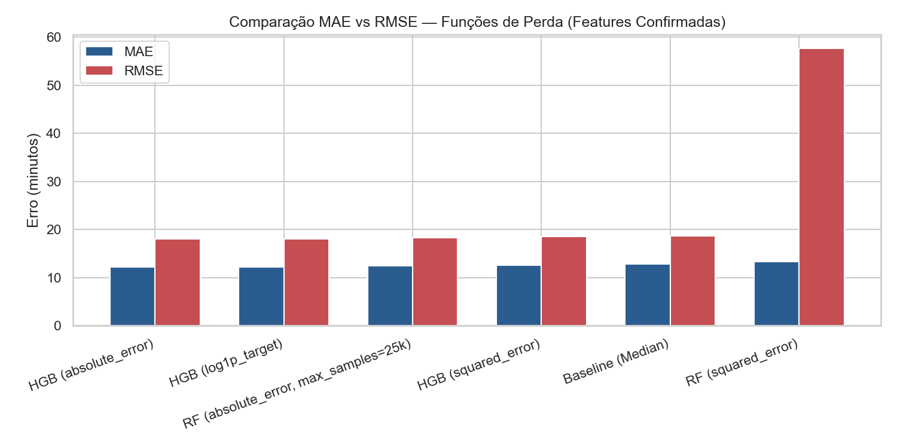
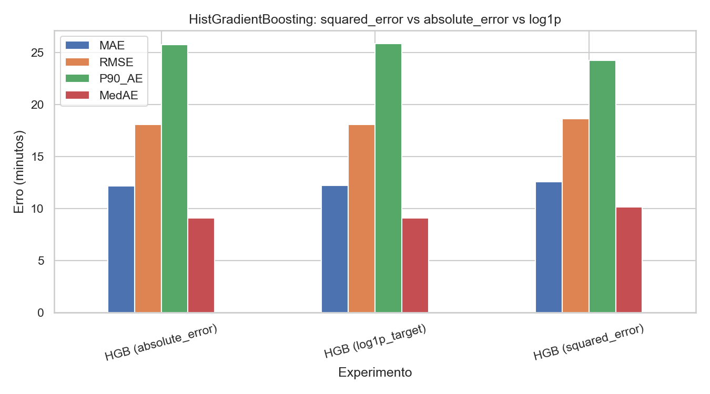
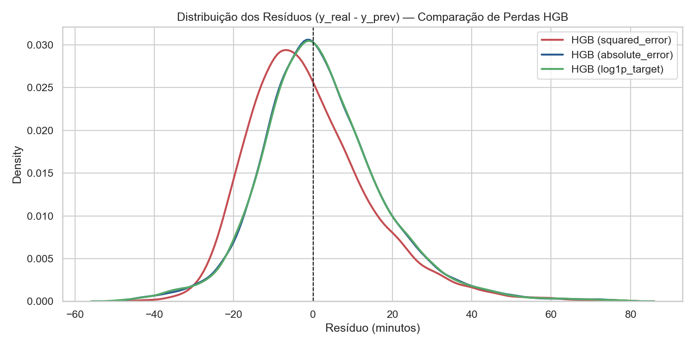
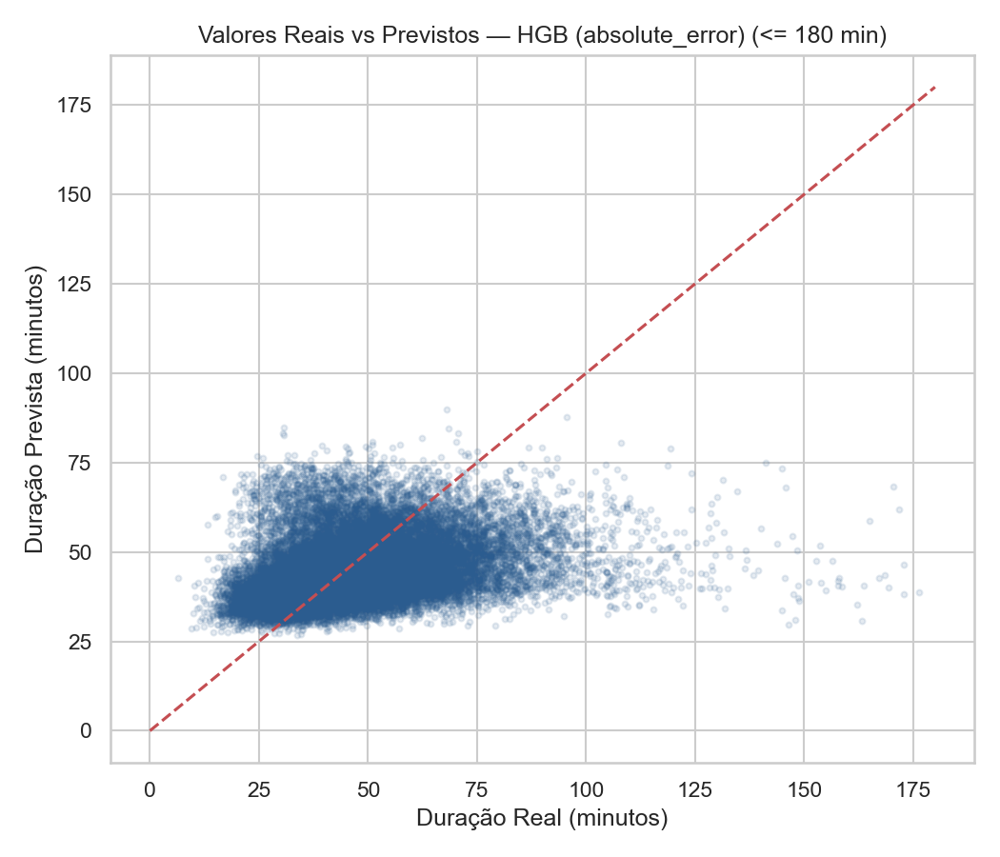
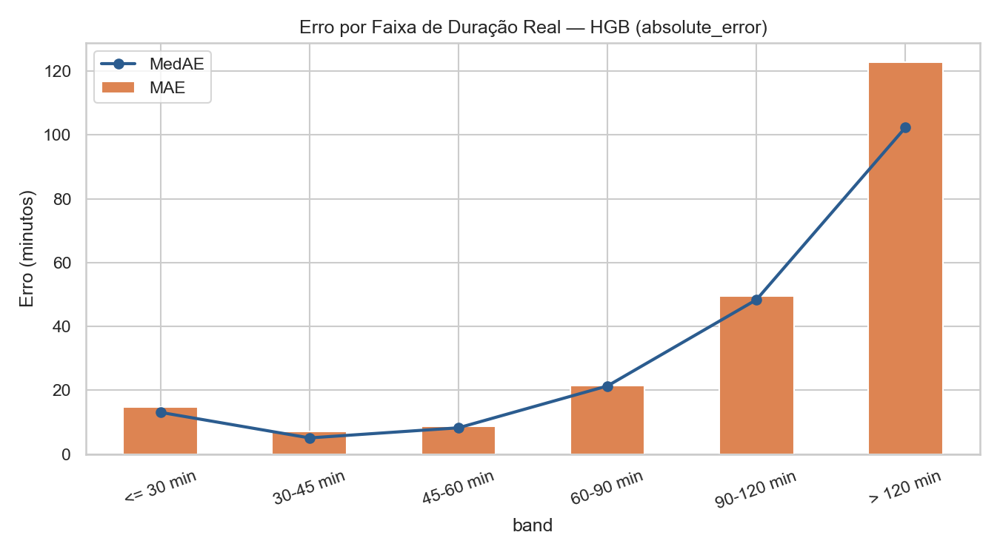

# DoorDash Delivery ETA — Relatório de Investigação de Outliers e Otimização dos Modelos (Etapa 06.1)

**Base avaliada:** Divisão temporal com embargo da Etapa 05 (`Treino: 138.572` | `Validação: 28.808` | `Teste: 30.041` mantido **100% isolado**)  
**Escala de avaliação:** Minutos originais (`delivery_duration_minutes`) em toda a validação (`n = 28.808`, sem remoção de outliers)

---

## 1. Verificação Documental: 22 vs 21 Features Confirmadas

- Na Etapa 05 ([temporal_validation_report.md](temporal_validation_report.md)), `CONFIRMED_FEATURES` passou a listar **`22` variáveis** após a adição da flag `invalid_item_price_range`.
- Na Etapa 06 ([model_training.py](../src/model_training.py)), o conjunto utilizado nos modelos (`CONFIRMED_MODEL_FEATURES`) contém **`21` variáveis** porque `store_id` (`6.743` IDs únicos) foi excluído explicitamente do One-Hot Encoding para evitar explosão dimensional em memória nos modelos baseados em árvore. Não houve alteração silenciosa de features.

---

## 2. Investigação dos Erros e Efeito dos Outliers `> 24h` (`squared_error`)

### 2.1 Diagnóstico de Erros na Validação (`n = 28.808`, 21 features confirmadas)

| Métrica Diagnóstica | `HGB (squared_error)` | `RF (squared_error)` |
| :--- | ---: | ---: |
| Previsões negativas (`< 0`) | 0 | 0 |
| Erros absolutos `> 30 min` | 1.532 | 1.998 |
| Erros absolutos `> 60 min` | 197 | 227 |
| Erros absolutos `> 90 min` | 65 | 72 |
| Erros absolutos `> 120 min` | 38 | 43 |
| Menor previsão | `1,96 min` | `31,86 min` |
| Maior previsão | `910,80 min` | **`5.126,32 min`** |
| Maior erro absoluto | `878,40 min` (real `32,40`, prev `910,80`) | **`5.085,49 min`** (real `40,83`, prev `5.126,32`) |

- **Por que isso ocorreu?** Existem **`2` registros `> 24h`** no conjunto de treino (`141.947,65 min` e `6.231,32 min`; `0` na validação). Sob perda quadrática (`squared_error`), esses `2` registros dominaram folhas específicas das árvores: na Random Forest, `4` pedidos normais da validação (`40–63 min`) caíram nessas folhas e receberam previsões entre `4.400,71` e `5.126,32 min`.

### 2.2 Experimento Separado: Removendo Apenas os `2` Registros `> 24h` do Treino

| Modelo | MAE | RMSE | MedAE | P90_AE | R² | Mean Bias |
| :--- | ---: | ---: | ---: | ---: | ---: | ---: |
| `HGB (squared_error)` — treino completo (`138.572`) | 12,5899 | 18,6019 | 10,1687 | **24,2369** | -0,0256 | +0,4587 |
| `HGB (squared_error)` — sem `> 24h` no treino (`138.570`) | **12,4663** | **18,1850** | **9,4358** | 26,0014 | **+0,0199** | -0,5367 |
| `RF (squared_error)` — treino completo (`138.572`) | 13,2946 | 57,7062 | 9,6265 | **26,1200** | -8,8698 | +0,4146 |
| `RF (squared_error)` — sem `> 24h` no treino (`138.570`) | **12,6733** | **18,4319** | **9,6215** | 26,2673 | **-0,0069** | -0,2682 |

- **Conclusão:** Apenas `2` registros extremos respondiam por quase toda a explosão do RMSE da Random Forest (`57,71` → `18,43 min`) e pelo R² negativo do HGB com `squared_error`.

---

## 3. Experimentos com Funções de Perda (Treino Completo `n = 138.572`, 21 Features Confirmadas)

### 3.1 Tabela Comparativa Ordenada por MAE

| Experimento | MAE | RMSE | MedAE | P90_AE | R² | Mean Bias | Median Bias | Treino (s) | Inferência (s) |
| :--- | ---: | ---: | ---: | ---: | ---: | ---: | ---: | ---: | ---: |
| **`HGB (absolute_error)`** | **12,1695** | **18,0551** | 9,0774 | 25,7305 | **+0,0338** | -2,7921 | -0,9019 | 9,84 | 0,356 |
| `HGB (log1p_target)` | 12,2073 | 18,0861 | **9,0659** | 25,8249 | +0,0305 | -2,7468 | -0,9613 | 9,77 | 0,481 |
| `RF (absolute_error, max_samples=25k)` | 12,4245 | 18,3413 | 9,3327 | 25,8130 | +0,0029 | -2,2857 | **-0,1577** | 71,87 | 0,128 |
| `HGB (squared_error)` | 12,5899 | 18,6019 | 10,1687 | **24,2369** | -0,0256 | +0,4587 | +3,1027 | 1,57 | 0,108 |
| `Baseline (Median)` | 12,8201 | 18,6790 | 9,9000 | 25,6667 | -0,0341 | -3,3927 | -0,6333 | 0,56 | 0,058 |
| `RF (squared_error)` | 13,2946 | 57,7062 | 9,6265 | 26,1200 | -8,8698 | +0,4146 | +1,4768 | 61,71 | 0,186 |

*(Nota sobre custo computacional: `RandomForestRegressor(criterion="absolute_error")` tem complexidade $O(N^2)$ por nó em 138k linhas; por isso foi executado com `n_estimators=50` e `max_samples=25.000` por árvore, levando `71,87 s`.)*

### 3.2 Comparação de Métricas e Trade-offs (`RMSE`, `P90_AE` e Viés)

- **Melhoria consistente em MAE, RMSE, MedAE e R²:** Sem remover nenhum outlier do treino, **`HGB (absolute_error)`** e **`HGB (log1p_target)`** superaram o baseline e o `HGB (squared_error)` em `MAE` (`12,17` vs `12,82`), `RMSE` (`18,06` vs `18,68`), `MedAE` (`9,08` vs `9,90`) e `R²` (`+0,0338` vs `-0,0341`).
- **Trade-off em P90_AE e Viés:** `HGB (squared_error)` manteve o menor `P90_AE` (`24,24` vs `25,73 min`), porque sua superestimação mediana (`+3,10 min`) reduz o erro nos pedidos moderadamente lentos, enquanto `absolute_error` e `log1p_target` aproximam a mediana condicional (gerando `Mean_Bias` negativo de `-2,79` / `-2,75 min` pela assimetria à direita).

### 3.3 Desempenho por Faixa de Duração Real (`HGB (absolute_error)`)

| Faixa de Duração Real | `n` | MAE (min) | MedAE (min) | P90_AE (min) | Mean Bias (min) |
| :--- | ---: | ---: | ---: | ---: | ---: |
| `<= 30 min` | 3.613 | 14,69 | 13,07 | 24,21 | +14,68 |
| `30-45 min` | 11.062 | **7,16** | **5,06** | 16,18 | +5,18 |
| `45-60 min` | 8.701 | 8,81 | 8,23 | 16,67 | -5,79 |
| `60-90 min` | 4.821 | 21,36 | 21,35 | 34,77 | -21,10 |
| `90-120 min` | 495 | 49,42 | 48,38 | 67,22 | -49,42 |
| `> 120 min` | 116 | 122,80 | 102,37 | 200,92 | -122,80 |

- Comparado ao `HGB (squared_error)`, o ganho principal ocorreu nas entregas rápidas/normais (`<= 30 min`: MAE caiu de `20,66` → `14,69`; `30-45 min`: `9,50` → `7,16`), enquanto entregas `> 120 min` continuam subestimadas.

---

## 4. Ablações Controladas (Disponibilidade Incerta — Separadas)

| Experimento | MAE | RMSE | MedAE | P90_AE | R² | Mean Bias | Treino (s) |
| :--- | ---: | ---: | ---: | ---: | ---: | ---: | ---: |
| **`HGB (absolute_error)` \| Confirmadas + Razões Operacionais (23)** | **11,0944** | **16,8967** | **8,2252** | **22,8805** | **+0,1538** | -2,8865 | 17,46 |
| `HGB (log1p_target)` \| Confirmadas + Razões Operacionais (23) | 11,1252 | 16,9194 | 8,2268 | 22,9640 | +0,1515 | -2,7403 | 14,57 |
| `HGB (absolute_error)` \| Confirmadas + Estimativas Driving (23) | 11,6450 | 17,5271 | 8,4796 | 24,8472 | +0,0895 | -2,9121 | 12,98 |
| `HGB (log1p_target)` \| Confirmadas + Estimativas Driving (23) | 11,7184 | 17,5989 | 8,5253 | 25,1305 | +0,0820 | -2,5692 | 10,55 |
| *Referência Conservadora: `HGB (absolute_error)` \| Confirmadas (21)* | *12,1695* | *18,0551* | *9,0774* | *25,7305* | *+0,0338* | *-2,7921* | *10,41* |

- **Atenção:** Os ganhos expressivos com **Razões Operacionais** (`MAE = 11,09 min`, `R² = +0,1538`) e **Estimativas de Driving** (`MAE = 11,65 min`, `R² = +0,0895`) dependem de variáveis cuja disponibilidade exata no instante `created_at` **ainda não foi confirmada**.

---

## 5. Recomendação para Avaliação Final

- **Modelo conservador recomendado:** **`HistGradientBoostingRegressor(loss="absolute_error")`** com as `21` features confirmadas (`MAE = 12,17 min`, `RMSE = 18,06 min`, `MedAE = 9,08 min`, `R² = +0,0338`, `9,84 s` de treino), por ser robusto aos outliers extremos sem exigir exclusão manual de registros e por superar consistentemente o baseline e a perda quadrática.
- **Candidato experimental para comparação controlada (caso avaliado separadamente):** `HistGradientBoostingRegressor(loss="absolute_error")` com `+ Razões Operacionais`, mantendo os resultados reportados separadamente do modelo conservador.
