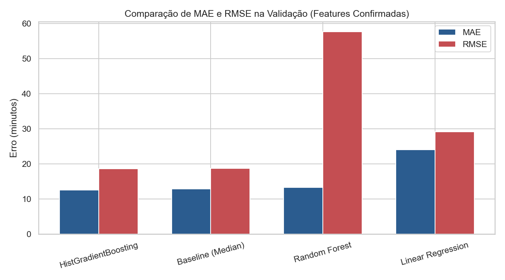
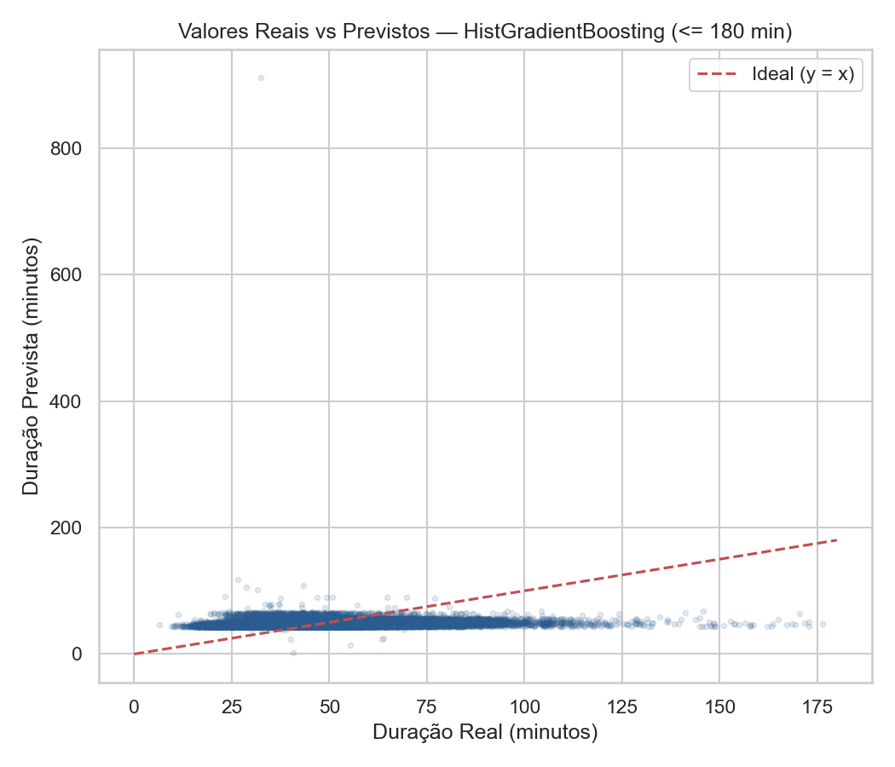
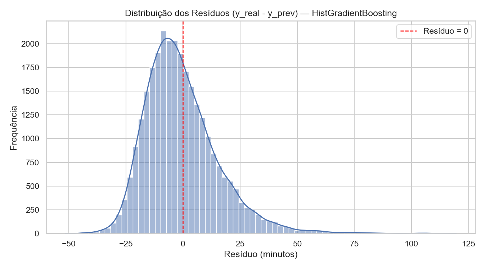
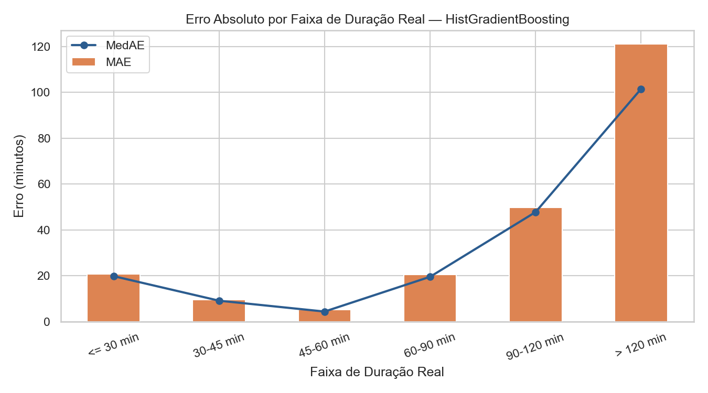

# DoorDash Delivery ETA — Relatório de Baseline e Primeiros Modelos (Etapa 06)

**Módulo:** [model_training.py](../src/model_training.py)  
**Notebooks:** [06_model_training.ipynb](../notebooks/06_model_training.ipynb) | [06_model_training_colab.ipynb](../notebooks/06_model_training_colab.ipynb) (autocontido para Google Colab)

---

## 1. Auditoria Pré-Treino e Isolamento do Teste

- **Treino:** `138.572` registros (`actual_delivery_time` máx: `2015-02-10 06:55:06` < `2015-02-10 10:00:00`).
- **Validação:** `28.808` registros (`actual_delivery_time` máx: `2015-02-14 08:14:56` < `2015-02-14 10:00:00`).
- **Teste:** `30.041` registros (`created_at` mín: `2015-02-14 14:37:07`) — **mantido 100% isolado**.
- **Sobreposição de índices:** `0`.

---

## 2. Features e Parâmetros Utilizados (Conjunto Conservador)

- **Features (`21` variáveis confirmadas):** `market_id`, `store_primary_category`, `order_protocol`, `total_items`, `subtotal`, `num_distinct_items`, `min_item_price`, `max_item_price`, `estimated_order_place_duration`, `created_hour`, `created_dayofweek`, `created_month`, `created_is_weekend`, `created_time_block`, `average_item_price`, `item_price_range`, `invalid_item_price_range`, `distinct_item_ratio`, `is_single_item`, `is_large_order`, `historical_store_order_count`.
  *(Nota: `store_id` com 6.743 níveis foi excluído do One-Hot Encoding nesta etapa inicial para evitar explosão dimensional em modelos baseados em árvore).*
- **Pré-processamento (ajustado apenas no treino):** Numéricas com `SimpleImputer(strategy="median")` (+ `StandardScaler` apenas na `LinearRegression`); categóricas com `SimpleImputer(strategy="constant", fill_value="missing")` + `OneHotEncoder(handle_unknown="ignore")`.
- **Parâmetros dos modelos:**
  - `Baseline (Median)`: `DummyRegressor(strategy="median")`
  - `Linear Regression`: `LinearRegression()`
  - `Random Forest`: `RandomForestRegressor(n_estimators=100, max_depth=15, min_samples_leaf=10, random_state=42)`
  - `HistGradientBoosting`: `HistGradientBoostingRegressor(max_iter=200, learning_rate=0.08, max_leaf_nodes=63, min_samples_leaf=30, random_state=42)`

---

## 3. Resultados na Validação — Conjunto Conservador (Ordenado por MAE)

| Modelo | MAE | RMSE | MedAE | P90_AE | R² | Mean Bias | Median Bias | Tempo (s) |
| :--- | ---: | ---: | ---: | ---: | ---: | ---: | ---: | ---: |
| **HistGradientBoosting** | **12,5899** | **18,6019** | 10,1687 | **24,2369** | **-0,0256** | +0,4587 | +3,1027 | 4,34 |
| Baseline (Median) | 12,8201 | 18,6790 | 9,9000 | 25,6667 | -0,0341 | -3,3927 | -0,6333 | 0,65 |
| Random Forest | 13,2946 | 57,7062 | **9,6265** | 26,1200 | -8,8698 | +0,4146 | +1,4768 | 61,99 |
| Linear Regression | 24,0825 | 29,1184 | 22,5120 | 43,9845 | -1,5130 | +15,7455 | +19,2849 | 2,29 |

- **Melhor modelo provisório:** **`HistGradientBoosting`**, único a superar o baseline simultaneamente em MAE (`12,59` vs `12,82 min`), RMSE (`18,60` vs `18,68 min`) e P90_AE (`24,24` vs `25,67 min`), com treinamento rápido (`4,34 s`).
- **Diagnóstico de viés e outliers:**
  - `Linear Regression` e `Random Forest` (perda quadrática sobre `y` bruto) sofreram forte distorção pelos outliers extremos do treino (como o registro de `98,6` dias), elevando o RMSE da Random Forest para `57,71 min` e o viés médio da Regressão Linear para `+15,75 min`.
  - O `HistGradientBoosting` apresenta **superestimação moderada na mediana (`+3,10 min`)** e leve na média (`+0,46 min`), pois a função de perda L2 é puxada pela cauda superior do treino.

---

## 4. Análise de Erro por Faixa de Duração Real (`HistGradientBoosting`)

| Faixa de Duração Real | `n` | MAE (min) | MedAE (min) | P90_AE (min) | Mean Bias (min) |
| :--- | ---: | ---: | ---: | ---: | ---: |
| `<= 30 min` | 3.613 | 20,66 | 19,81 | 26,72 | +20,66 |
| `30-45 min` | 11.062 | 9,50 | 9,09 | 15,83 | +9,46 |
| `45-60 min` | 8.701 | 5,20 | 4,35 | 10,90 | -3,28 |
| `60-90 min` | 4.821 | 20,56 | 19,53 | 32,40 | -20,52 |
| `90-120 min` | 495 | 49,67 | 47,79 | 62,56 | -49,67 |
| **`> 120 min`** | **116** | **121,14** | **101,57** | **199,72** | **-121,14** |

- O modelo concentra suas previsões perto da região central (`35–55 min`), superestimando entregas rápidas (`<= 30 min`) e subestimando severamente atrasos acima de `90` e `120` minutos.

---

## 5. Experimentos de Ablação (EXPERIMENTAIS — Disponibilidade Incerta)

*(Avaliados separadamente com `HistGradientBoosting`; **não devem ser misturados ao resultado conservador sem confirmar disponibilidade em produção**.)*

| Experimento | MAE | RMSE | MedAE | P90_AE | R² | Mean Bias | `N_Features` |
| :--- | ---: | ---: | ---: | ---: | ---: | ---: | ---: |
| **Exp 4 (+ Todas Experimentais)** | **11,9411** | 20,3288 | **9,4854** | **22,0152** | -0,2249 | +0,5444 | 31 |
| **Exp 3 (+ Razões Operacionais)** | **11,9675** | **17,8107** | 9,6689 | 22,8855 | **+0,0598** | +0,2188 | 23 |
| Exp 1 (+ Estimativas Driving/Total) | 12,2105 | 18,2294 | 9,9699 | 23,0778 | +0,0151 | +0,5289 | 23 |
| Exp 2 (+ Operacionais Base) | 12,4420 | 20,6432 | 9,8258 | 23,3857 | -0,2630 | +0,5264 | 27 |
| *Referência: Conservador (Confirmadas)* | *12,5899* | *18,6019* | *10,1687* | *24,2369* | *-0,0256* | *+0,4587* | *21* |

- **Destaque:** A inclusão das **razões operacionais** (`Exp 3`) reduziu o MAE em `0,62 min` (`12,59` → `11,97`), reduziu o RMSE para `17,81` e tornou o R² positivo (`+0,0598`). `Exp 1` (estimativas de deslocamento) também melhorou MAE (`12,21`) e RMSE (`18,23`).

---

## 6. Limitações e Próximos Passos

1. **Função de perda e outliers:** Treinar com `loss="squared_error"` expõe os modelos aos outliers extremos (`> 24h`) no treino; testar `loss="absolute_error"` (MAE) ou transformação `log1p(y)` na próxima etapa pode reduzir o viés e melhorar `Random Forest` / `HistGradientBoosting`.
2. **Representação de `store_id`:** Incorporar *target encoding* temporal estritamente causal por loja (ou `OrdinalEncoder` em árvores) para capturar a forte variabilidade entre lojas (`29` a `75 min`).
3. **Validação de produção:** Confirmar se `estimated_store_to_consumer_driving_duration` e as razões operacionais estão disponíveis no momento do pedido antes de adotá-las no modelo final.
